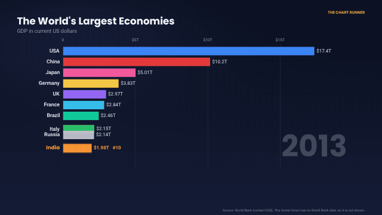
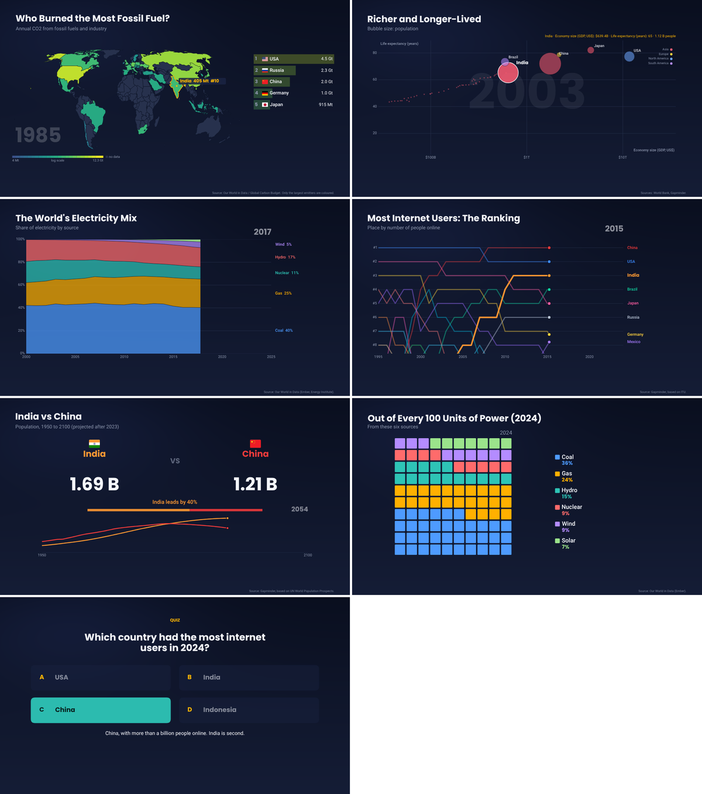
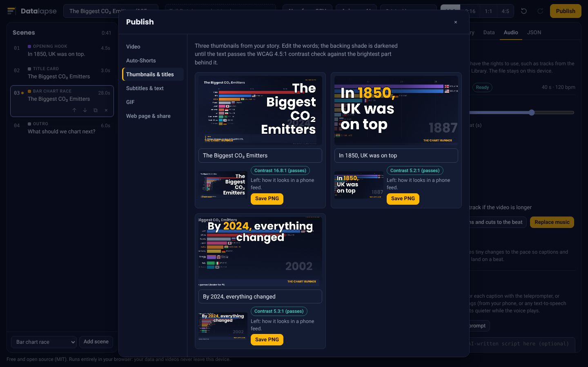
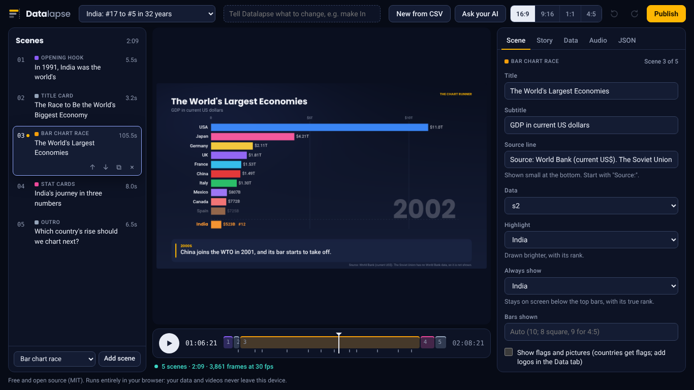
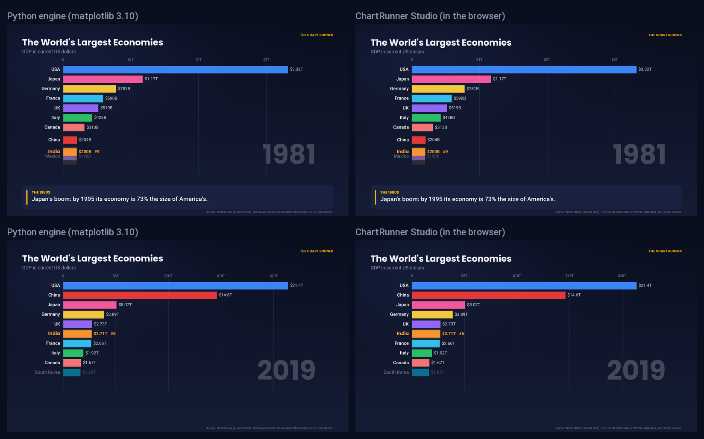

# Datalapse

**Turn a spreadsheet into a data-documentary video in your browser.** Bar chart races, world maps, moving bubbles, rankings and more, with captions that explain what happened, music that lands on the beat, and subtitles in other languages. Nothing to install, no account, no watermark. Your data never leaves your device.



**[Open the studio](https://himanshuafmc.github.io/datalapse/)** · [Story Spec](docs/STORY_SPEC.md) · [Command line](#command-line) · [For AI coding agents](AGENTS.md) · [Data sources](DATA_SOURCES.md)

Drop in a CSV, press play, and Datalapse writes a complete story: an opening hook, a title card, the race itself with captions at the dramatic moments, recap cards and an outro. Edit anything by clicking it or by typing what you want ("make India saffron", "slow down around 1991"), then publish a 1080p video, a Short, a GIF, thumbnails, subtitles and an interactive web page from the same story.

## What's in it

**Make the story**
- **CSV to finished video in minutes.** Upload or paste a table; the studio works out its shape and number format, cleans country names, and writes the story.
- **Drama finder.** Scans the data for lead changes, overtakes, records, crashes, surges and long reigns, writes a caption for each, and slows the race down into each moment.
- **Fact-checked captions.** Every number, rank and year in a caption is checked against the data, with a badge: matches, partly checked, or doesn't match.
- **Data doctor.** Spots gaps, sudden jumps, negative values and totals mixed in with countries, and fixes them in a click: per person (built-in population figures), inflation-adjusted (US CPI), rolling averages, running totals, change from a year, index to 100, shares, filling gaps, rolling countries up to continents.
- **Plain-language editing.** Type "highlight China", "pause at 2008 for 3 seconds", "make it 90 seconds", "show flags", "translate to Hindi". Anything the command box doesn't understand can go to Claude (on claude.ai) or any AI you paste it into.
- **Public data catalogue (optional, online).** 27 well-known indicators from the World Bank, Our World in Data and Gapminder, one click each. Off until you turn it on, and it can reach only those three sites.

**Fifteen scene types**
Opening hook, title card, bar chart race, line race, **map race**, **bubble chart** (Rosling style), **stacked areas**, **bump chart** (ranks over time), **head to head**, 100-dot grid, **waffle**, growing bars, stat cards, **quiz**, outro. Any scene can enter with a crossfade, slide or zoom, and have **camera moves**; races can **spotlight** one entity while the rest dim.



**Look and sound**
- **Flags** beside every country (and your own logos or pictures for anything else), a channel name and logo, three themes, brand kits, and a **colour-blind-safe palette**.
- **Music with beat sync.** Add a track; Datalapse finds its tempo and nudges captions and scene cuts onto the beat. Music fades and ducks under narration automatically.
- **Narration.** Record each line with the built-in teleprompter, import recordings, or (optional, online) have a **free AI voice** (Kokoro, English) read the script on your device. The race can pause while the narrator speaks.
- **Many languages from one story.** Translate the text in the Story tab (or let Claude do it); 18 languages get country names automatically, Hindi and Devanagari text is embedded in the fonts, and Hindi and Marathi videos use lakh and crore.

**Publish**
- **Four formats from the same story:** 16:9 for YouTube, 9:16 for Shorts, Reels and TikTok, 1:1 and 4:5 for Instagram, LinkedIn and X. Layouts are designed for each.
- **Videos** in every format and language in one go: MP4 (H.264) where the browser has an encoder, WebM (VP9) otherwise, with the soundtrack mixed in.
- **Auto-Shorts:** short vertical clips cut around the race's most dramatic moments, each with its own hook and end card.
- **Thumbnails and titles:** three 1280 × 720 thumbnails whose text is checked for contrast (WCAG 4.5:1) and previewed at phone size, plus title ideas with length warnings.
- **Subtitles** (.srt and .vtt) in every language, an **audio description track** that says what each chart shows, and YouTube text with chapters, tags and sources.
- **GIFs** of any moment, for READMEs, slides and chat.
- **An interactive web page:** one .html file that plays the story in any browser, where viewers can pause on any year, switch format or language, and download the data. Embed it in a blog.
- **Share links** that carry the whole story after the `#` (nothing is uploaded), and a **story fingerprint** (`dl1-…`) in the YouTube text so anyone with the story file can check it and render the same video.



## Open the studio

The whole app is one HTML file, `dist/index.html` (about 1.4 MB, fonts, flags, world map and examples included).

- **Online:** [himanshuafmc.github.io/datalapse](https://himanshuafmc.github.io/datalapse/), published from this repository by `.github/workflows/pages.yml` on every push to `main`. In a fork, switch on Pages (Settings › Pages › Source: GitHub Actions) to get your own copy.
- **Offline:** save that page (Ctrl+S), or build it yourself, and double-click the file. Everything except the two optional online features works without a connection.
- **From source:** `npm install && npm run build`, then open `dist/index.html`.



## Make your first video

1. Click **New from CSV**. Drop a file, paste from a spreadsheet, try the sample data, or browse public data.
2. Check how the table was read (fix any country names it suggests), choose bar race or line race, and give it a title and source. Click **Create story**.
3. Press play. Click a scene to edit it, or type a change in the command box. Try **Find dramatic moments** in a race scene.
4. Optional: add music and narration in the **Audio** tab, languages in the **Story** tab.
5. Click **Publish**: pick formats and languages, render, then make Shorts, thumbnails, subtitles or a web page.

### CSV shapes the importer understands

| Shape | Example |
|---|---|
| One column per entity | `Year, India, China, USA` |
| Long format | `Date, Country, Value` (repeated rows are added up) |
| Years across the top | World Bank and many government downloads |

Dates can be years (`1999`), months (`2020-04`, `Apr 2020`, `04/2020`), quarters (`Q3 2021`), days (`15/08/2021`) or financial years (`2011-12`). Numbers can carry currency signs, `%`, thousands separators in US, Indian or European style, `(450)` for negatives, and `K M B T lakh cr` suffixes.

## Exporting

| Browser | What you get |
|---|---|
| Chrome or Edge on Windows and macOS | MP4 (H.264), usually faster than real time |
| Chrome on Linux, Firefox | WebM (VP9), which YouTube accepts |
| Browsers without WebCodecs | Real-time recording (export takes as long as the video) |

The studio draws a full-HD frame in about 1 ms, so the encoder sets the pace. On the 2-core Linux test machine, software VP9 ran at about 2× real time. H.264 has not been tested on that machine because its browsers have no H.264 encoder; the MP4 container path is tested with VP9 inside it.

## Command line

Render story files without opening the studio, for example in a scheduled job. It drives the same page in a headless browser, so the output matches the studio.

```bash
npm install
npx playwright install chromium        # or have Google Chrome installed (used first; it can make MP4)
node cli/datalapse.mjs check stories/*.json
node cli/datalapse.mjs render stories/v01_india_gdp_race.json --format landscape,vertical --lang all \
     --text --thumbs --shorts 3 --gif 3:20-28 --page --out out
```

`.github/workflows/render.yml` does the same on GitHub Actions whenever a story in `stories/` changes, and attaches the files to the run. Audio lives in the browser that added it, so command-line renders are silent.

## Privacy

The standalone build ships with a Content-Security-Policy. Datalapse makes no network requests on its own: CSVs are read with the browser's file APIs, videos are encoded in memory, drafts and audio stay in your browser's storage, and there is no analytics. The two online features (public data catalogue, AI voice) are off until you turn them on, say exactly which sites they use, and the policy lets the browser connect only to those sites: `api.worldbank.org`, `ourworldindata.org`, `raw.githubusercontent.com` for data; `cdn.jsdelivr.net` and Hugging Face for the voice. The exported web page cannot connect anywhere.

## Built on a tested Python engine

The original scenes are a JavaScript port of a Python and matplotlib engine (kept in `reference/python`). The port is checked against the original, not eyeballed:

- `npm run parity` replays all seven example stories in both engines, in both original formats, and compares 1.89 million computed values (data time per frame, interpolated values, bar positions, ranks, axis ranges, caption timing) and 57,000 recorded draw calls. They match to within 3 × 10⁻¹⁶. Ties between equal values may be ordered differently, because NumPy's sort order for ties depends on the CPU.
- `npm test` runs 21,000 checks: the ports of Python's number formatting (including round-half-to-even), `textwrap`, NumPy's `interp` and matplotlib's tick locators against answers recorded from Python, plus the drama finder, fact checks, data doctor, beat detection, Shorts, fingerprints, share links and every scene in all four formats.
- New features are off by default, so existing stories render exactly as before.



## Develop

```bash
npm install
npm run build      # dist/index.html and dist/artifact.html
npm test           # unit tests (no Python needed)
npm run parity     # full comparison with the Python engine (needs python3, numpy, pandas, matplotlib)
npm run verify     # headless Chromium: screenshots, CSV import, catalogue, Shorts, GIF, web page, share link, a real export
```

No framework; three runtime dependencies (`mp4-muxer`, `webm-muxer`, `gifenc`). Start with [AGENTS.md](AGENTS.md) for the layout of the code and the rules that keep the engine honest, and [docs/STORY_SPEC.md](docs/STORY_SPEC.md) for the story format.

```
src/core      numbers, easing, pace, captions, ticks, text wrapping, layouts for the four formats
src/scenes    one file per scene type (the plug-in boundary)
src/render    the Canvas figure, background, fonts, flags, world map, Video (frames from a story)
src/export    video, GIF, Shorts, thumbnails, subtitles, audio description, web page, share links, fingerprint
src/audio     music library, beat detection, mixing, narration timing
src/data      CSV import, country names, drama finder, fact checks, data doctor, story writer
src/online    the two opt-in online features and the list of sites they may use
src/spec      validation, translations, plain-language commands, the AI prompt
src/app       the studio interface and the web-page player
cli           the command-line renderer
reference     the original Python engine, its stories and data
tests         unit tests, parity tests, UI verification
```

## Licences

Code: MIT, see [LICENSE](LICENSE). Fonts: Poppins (SIL Open Font License 1.1) and Roboto (Apache 2.0). Flags: flag-icons (MIT). Map outlines: Natural Earth (public domain) via world-atlas (ISC). GIF encoder: gifenc (MIT). Example data: see [DATA_SOURCES.md](DATA_SOURCES.md); credit the sources when you publish videos made from them.
